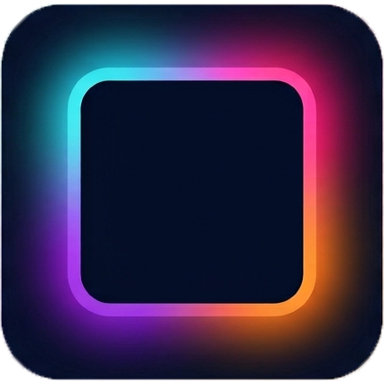

<p align="center">
    
</p>

<h1 align="center">Ambilight by Levurgi4</h1>

<p align="center"><strong>Свет не заканчивается на границе экрана.</strong></p>

> Ищете обзор возможностей без деталей сборки и протокола?
> Откройте [пользовательский README о продукте](README_PRODUCT.md).
> Для установки на чистую Windows используйте
> [пошаговую инструкцию запуска](docs/installation-windows.md).

**Ambilight by Levurgi4** — домашняя фоновая подсветка для телевизора:
приложение на Windows анализирует изображение, а ESP32 превращает цвета по
краям кадра в свет на адресной ленте WS2815.

Проект создаётся для фильмов, игр и музыки с упором на плавность, минимальную
задержку и удобную настройку. Количество светодиодов, начальная точка и
направление ленты задаются программно, поэтому неудачный выбор места монтажа
не должен заканчиваться переклейкой всей ленты.

## ✨ Что умеет проект

- захватывает выбранный экран через DXGI Desktop Duplication;
- рассчитывает цвета периметра на GPU с помощью D3D11 compute shader;
- захватывает звук Windows через WASAPI loopback, микрофон либо оба источника
  и строит круговой FFT-эквалайзер без записи звука;
- предлагает плавную или «пружинную» динамику частотных зон с настраиваемым
  затухающим перелётом после резких ударов;
- предлагает три режима для чёрных полос: не исключать, искать первый видимый
  контент со всех сторон или ограничить поиск сверху и снизу рамкой 21:9;
- сглаживает быстрые переходы и отдельно подавляет резкие вспышки общей
  яркости с настраиваемой силой;
- настраивает от 4 до 300 логических зон и глубину захвата от края:
  Auto — 8–160 px, вручную — 8–512 px;
- показывает прямо в предпросмотре цветную карту областей захвата, границы всех
  зон и фактическую глубину с учётом обнаруженных чёрных полос;
- автоматически уплотняет выборку с 32 до 128 точек на зону при увеличении
  глубины;
- позволяет сравнить среднее, среднеквадратичное и доминирующее определение
  цвета с явной пометкой относительной нагрузки на GPU;
- исправляет завышенную яркость теней с помощью рекомендуемого преобразования
  `sRGB → LED` и предлагает мягкую либо усиленную гамма-коррекцию;
- интерполирует зоны в настраиваемую раскладку до 300 светодиодов;
- открывает отдельное окно настройки четырёх сторон, положения `LED 0` и
  направления с живым цветовым тестом физической ленты;
- программно смещает `LED 0` и меняет направление обхода ленты;
- передаёт готовые RGB-кадры на ESP32 по USB-UART;
- ограничивает яркость и расчётный ток уже на контроллере;
- калибрует красный, зелёный и синий каналы для нейтрального белого;
- поддерживает автономные эффекты «цвет», «дыхание», «волна» и «радуга»;
- временно запускает выбранную анимацию при подключённом ПК и одной кнопкой
  возвращает Ambilight;
- работает из системного трея, запускается вместе с Windows и поддерживает
  глобальную горячую клавишу;
- подстраивает размер окна под выбранную вкладку и показывает встроенную
  справку по каждому разделу;
- переключает русский и английский интерфейс без перезапуска.

Целевая конфигурация: Windows 11, ESP32-WROOM-32D и до 300 светодиодов WS2815
с питанием 12 В. Ориентир штатного режима — 60 FPS и общая задержка около
20–30 мс.

Для WS2815 приложение показывает номинал 12,0 В и абсолютный верхний предел
13,5 В. Предел не является рабочей настройкой: блок питания следует держать
на 12,0 В, а 12 В нельзя подавать на ESP32.

## 🚦 Текущее состояние

Программная цепочка текущего этапа собрана:

```text
DXGI → GPU-зоны → раскладка физической ленты → COM 2 Мбит/с
     → COBS + CRC-32C → ESP32 → ограничение яркости/тока → RMT → WS2815
```

На стороне Windows уже реализованы:

- выбор DXGI-экрана и живой предпросмотр виртуальной ленты;
- по возможности запоминает физический дисплей по стабильной DisplayConfig-
  идентичности и мигрирует старые настройки `\\.\DISPLAYn`; автоматический
  режим повторно определяет основной экран после изменения конфигурации
  мониторов;
- безопасный автоматический или ручной выбор COM-порта: первое подключение
  выбирается вручную, после успешного handshake приложение запоминает
  постоянную SetupAPI-идентичность контроллера (VID/PID, Container ID и
  уникальный USB serial), а номер COM использует только как подсказку;
  мосты без достоверного уникального serial остаются в ручном режиме, поэтому
  посторонние COM-устройства никогда не зондируются автоматически;
- нативный Windows COM-транспорт `2 000 000, 8-N-1` без зависимости от
  Qt SerialPort;
- DTR и RTS принудительно отключаются после открытия и затем намеренно не
  импульсируются приложением;
- рукопожатие `Hello → DeviceInfo` с паузой после открытия и повторами на том
  же порту, подтверждения управляющих команд, опрос состояния и автоматическое
  переподключение;
- приоритет команд конфигурации над видеопотоком;
- очередь только на один самый свежий LED-кадр: устаревший кадр заменяется,
  а не накапливает задержку;
- повтор последнего кадра с новым номером последовательности, когда картинка
  на экране статична. Это поддерживает активной аренду Ambilight на ESP32.

Прошивка принимает конфигурацию и RGB-кадры, рендерит автономные эффекты и при
потере потока переключается на выбранный резервный режим. Если ESP32 питается
отдельно, эффект продолжает работать после выключения ПК. Настройки пока не
записываются в энергонезависимую память: после перезапуска контроллер безопасно
возвращается в `Off` и ждёт конфигурацию от приложения.

Аппаратный вывод WS2815 через RMT реализован. Для собранного прототипа в
`sdkconfig.defaults` выбран GPIO18; он подключён к DI через последовательный
резистор согласно физической схеме. Безопасный no-op backend по-прежнему
доступен при `CONFIG_AMBILIGHT_LED_DATA_GPIO=-1` для отладки без ленты.

> [!IMPORTANT]
> GPIO18 относится только к собранному прототипу с общей землёй и согласованной
> схемой питания. Не используйте эту сборку на другой разводке вслепую и не
> подавайте 12 В на ESP32. Прямой сигнал 3,3 В работает на текущем коротком
> соединении; буфер уровня остаётся вариантом при фактических помехах.
>
> Согласованная топология, допустимые подготовительные работы и порядок первой
> аппаратной проверки записаны в [физической схеме](docs/hardware-wiring.md).

## 🧪 Что проверено

Без оборудования собираются desktop-приложение и прошивка ESP-IDF с
безопасным `GPIO=-1`. Автоматические тесты покрывают:

- COBS, CRC-32C, заголовки и полезные нагрузки общего протокола;
- настройки приложения, раскладку периметра и вспомогательную логику захвата;
- формирование desktop-пакетов, валидацию подключения и очередь
  «управление прежде кадров, только последний кадр»;
- формирование байтов для всех шести порядков RGB, максимальную ленту на
  300 LED, безопасный список GPIO и дробный темп 60 Гц;
- ограничение яркости и тока для чёрного и полностью белого кадра, а также
  отклонение физически невозможного лимита ниже оценочного тока покоя ленты;
- оба профиля сигнала: классический WS2815 и revised WS2815B-V1.

На собранном прототипе подтверждены:

- CH9102X, ручной выбор COM, рукопожатие и обмен на скорости 2 Мбит/с;
- физический вывод GPIO18 на все 300 LED и порядок каналов `RGB`;
- основные цвета, белый, регулировка яркости и поканальный баланс белого;
- применение конфигурации, аппаратный тест расположения и питание ленты с
  начала и конца.

Ещё предстоят длительная проверка нагрева и стабильности, калибровка расчётного
лимита тока измерительным прибором, точное измерение 4K/60 FPS и сквозной
задержки 20–30 мс, а также NVS-сохранение автономных настроек.

## 🧩 Из чего состоит проект

| Каталог | Назначение |
| --- | --- |
| `desktop/` | Приложение Windows на C++20 и Qt 6 Widgets |
| `firmware/` | Прошивка ESP-IDF для ESP32 |
| `shared/protocol/` | Общий формат пакетов и переносимые кодеки |
| `docs/` | Архитектура, USB-UART-протокол и физическая схема |
| `assets/branding/` | Логотип и другие фирменные материалы |
| `LICENSES/` | Тексты лицензий распространяемых сторонних компонентов |

## 🖥️ Сборка приложения Windows

Понадобятся:

- Visual Studio 2022 с компонентами разработки на C++;
- CMake 3.24 или новее;
- Qt 6.10.3 для MSVC 2022 x64.

```powershell
cmake --preset windows-debug
cmake --build --preset windows-debug
ctest --preset windows-debug
```

Release-сборка:

```powershell
cmake --preset windows-release
cmake --build --preset windows-release
ctest --preset windows-release
```

Чтобы получить запускаемый комплект вместе с Qt DLL и плагинами, установите
его в абсолютный путь:

```powershell
$installDir = Join-Path (Get-Location) "out\install\windows-release"
cmake --install out/build/windows-release --config Release --prefix $installDir
& "$installDir\bin\Ambilight by Levurgi4.exe"
```

Чтобы собрать готовый ZIP для переноса на другой компьютер:

```powershell
powershell.exe -NoProfile -ExecutionPolicy Bypass -File `
    .\tools\package_windows.ps1 -Version 0.2.9
```

Архив и его контрольная сумма появятся в `out\packages`. В portable-комплект
также включается папка `Colour test` с пользовательскими изображениями и видео
для проверки подсветки. Теги вида `v*` автоматически собирают архив и
публикуют его в GitHub Releases вместе с контрольной суммой SHA-256.

## 🔌 Сборка прошивки

Откройте установленную Espressif консоль `IDF_v6.0.2_Powershell`:

```powershell
Set-Location C:\Dev\Ambient-Light-for-TV\firmware
idf.py set-target esp32
idf.py build
```

Текущий `sdkconfig.defaults` предназначен для согласованного прототипа и уже
выбирает GPIO18. Для новой или неизвестной разводки сначала установите
`CONFIG_AMBILIGHT_LED_DATA_GPIO=-1` через `idf.py menuconfig`, проверьте USB и
схему без физического выхода, а затем выберите подтверждённый GPIO в разделе
`Ambilight hardware`.

## 🎨 Логотип

Фирменные материалы находятся в `assets/branding/`:

- текущий растровый оригинал — `AmbiLight Logo.png`;
- канонический квадратный `logo.png` используется в этом README;
- из оригинала подготовлены Windows-иконка `.ico`, значок окна и размеры для
  системного трея;
- при появлении векторного исходника его можно сохранить как `logo.svg`.

Подробнее — в `assets/branding/README.md`.

## ⚖️ Лицензия

Исходный код Ambilight by Levurgi4 распространяется по [лицензии MIT](LICENSE).
Portable-сборка динамически использует Qt под LGPLv3 и включает Microsoft
Visual C++ Runtime. Подробности, тексты лицензий и порядок получения точных
исходников Qt находятся в [уведомлении о сторонних компонентах](THIRD_PARTY_NOTICES.md).

---

Сделано для того самого момента, когда выключается свет, запускается фильм —
и стена за телевизором тоже становится частью кадра.
