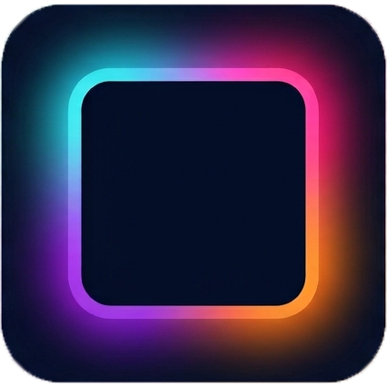

<p align="center">
    
</p>

<h1 align="center">Ambilight by Levurgi4</h1>

<p align="center">
    <strong>Подсветка, которая продолжает изображение за пределами экрана.</strong>
</p>

<p align="center">
    Фильмы становятся атмосфернее, игры — выразительнее, а адресная RGB-лента
    превращается в часть домашнего экрана.
</p>

> [!NOTE]
> Это обзор продукта для пользователя. Сборка, устройство проекта и другие
> технические подробности находятся в [README для разработки](README.md).
> Пошаговая установка, первый запуск и устранение ошибок описаны в
> [инструкции для чистой Windows 11](docs/installation-windows.md).

Готовую portable-сборку можно скачать на странице
[GitHub Releases](https://github.com/levurgi4/Ambient-Light-for-TV/releases).
Используйте архив целиком: в него входят приложение, необходимые
Qt-библиотеки, лицензия и уведомления о сторонних компонентах.

## Что это такое

**Ambilight by Levurgi4** — система фоновой подсветки телевизора или монитора.
Приложение для Windows следит за цветами по краям изображения и передаёт их
на ESP32, а контроллер в реальном времени управляет адресной лентой WS2815.

Свет на стене повторяет происходящее на экране:

- тёплое закатное небо выходит за границы телевизора;
- вспышки, неон и игровые эффекты заполняют комнату;
- чёрные полосы в кино не превращают верх и низ подсветки в бесполезные
  тёмные зоны;
- когда экран не нужен, лента работает как самостоятельная декоративная
  подсветка;
- музыка превращается в круговой частотный спектр по периметру экрана.

## Для фильмов, игр и атмосферы

### 🎬 Кино

Настройка чёрных полос помогает подсветке реагировать на сам фильм, а не на
пустую часть кадра. Можно искать первый видимый контент со всех четырёх сторон
либо ограничить поиск только верхом и низом до рамки 21:9 — этот безопасный
вариант особенно удобен для кино 21:9 на телевизоре 16:9.
Преобразование `sRGB → LED` отдельно возвращает тёмным сценам правильную
глубину: слабые оттенки больше не превращаются в непропорционально яркий свет,
а полный белый сохраняет максимальный уровень.

### 🎮 Игры

Захват изображения и расчёт цветов спроектированы с приоритетом низкой
задержки. Цель проекта — плавные 60 FPS и отклик порядка 20–30 мс в штатном
режиме; окончательные цифры будут измерены на готовом устройстве.

### 🎵 Музыка

Эквалайзер захватывает звуки Windows, выбранный микрофон или оба источника
одновременно. Низкие и высокие частоты распределяются по разным участкам
ленты, а чувствительность, порог тишины, скорость загорания и затухания можно
подстроить под комнату и жанр.

### 🌈 Декоративный свет

ESP32 умеет самостоятельно показывать постоянный цвет, дыхание, волну и
радугу. При отдельном питании контроллера эти эффекты могут продолжать
работать, даже когда ПК выключен.

## Возможности

- выбор нужного телевизора или монитора;
- корректная нормализация сторон для 21:9 и 16:9 и восстановление захвата
  после смены разрешения;
- работа, когда телевизор остаётся единственным активным экраном;
- до 300 адресных светодиодов;
- отдельное количество цветовых зон — от 4 до 300, независимо от числа LED;
- автоматическая или ручная глубина захвата цвета от края изображения;
- цветная карта областей захвата с границами отдельных зон и фактической
  глубиной, автоматически сдвигаемая к краю контента после исключения чёрных
  полос;
- адаптивное количество от 32 до 128 исходных точек на цветовую зону;
- выбор между средним, среднеквадратичным и доминирующим цветом с указанием
  относительной нагрузки на GPU прямо в интерфейсе;
- отдельное окно настройки количества LED сверху, справа, снизу и слева,
  положения `LED 0` и направления с применением изменений к цветовой
  проверке в реальном времени; тест горит непрерывно и умеет заливать одну
  выбранную сторону белым;
- программное смещение начального светодиода;
- смена направления обхода без переклеивания ленты;
- настройка порядка цветовых каналов;
- интерактивная калибровка баланса белого по каналам R/G/B;
- проверка физического расположения разноцветными сторонами и меткой LED 0;
- автоматическое обнаружение чёрных полос;
- настраиваемое временное сглаживание и защита от резких вспышек;
- звуковой эквалайзер с локальным WASAPI-захватом Windows, микрофона или обоих
  источников без записи звука;
- от 4 до 64 логарифмических частотных зон, зеркальная или круговая раскладка,
  частотный градиент либо один выбранный цвет;
- плавная или пружинная реакция спектра: после удара зона может немного
  перелететь целевую яркость, качнуться обратно и постепенно успокоиться;
- быстрый запуск эквалайзера прямо со вкладки звука, живой индикатор уровня и
  отдельный возврат рекомендуемых параметров без сброса ленты и подключения;
- ограничение яркости и расчётного потребления;
- временный запуск выбранной автономной анимации прямо при подключённом ПК;
- отдельный выбор цвета для режима и автономной заглушки «Сплошной цвет»;
- живой предпросмотр расположения и цветов ленты;
- компактный интерфейс со встроенной справкой на каждой вкладке;
- работа из системного трея;
- запуск вместе с Windows;
- глобальная горячая клавиша включения и выключения;
- русский и английский интерфейс;
- автоматическое переподключение к подтверждённому контроллеру;
- постоянный индикатор связи с быстрым переходом к настройкам COM-порта.

## Как это работает

```text
Изображение на экране ─┐
                       ├→ Приложение Ambilight для Windows
Звук Windows/микрофон ─┘
                       ↓ USB
ESP32-WROOM-32D
        ↓
Лента WS2815 за телевизором
        ↓
Цветное свечение на стене
```

Монтаж ленты не требует заранее угадывать идеальное место для `LED 0`.
Начальную точку и направление можно поправить в приложении уже после
наклеивания.

## Что понадобится

| Компонент | Планируемая конфигурация |
| --- | --- |
| Компьютер | Windows 11 |
| Экран | Телевизор или монитор, сейчас — SDR до 4K/60 Гц |
| Контроллер | ESP32-WROOM-32D с USB-UART CH9102X и разъёмом microUSB |
| Лента | WS2815, номинально 12,0 В, до 300 LED |
| Питание | Отдельный подходящий блок питания для ленты |
| Монтаж | Провода, общая земля и последовательный резистор линии данных |

microUSB на используемой плате служит подключением к USB-UART. Компьютер
передаёт через него команды и цвета, а питание 12-вольтовой ленты подаётся
отдельно.

> [!WARNING]
> Лента и мощный блок питания требуют правильно рассчитанных проводов,
> соединений, защиты и распределения питания. Не подключайте 12 В напрямую к
> ESP32 и не собирайте силовую часть без утверждённой схемы. Текущая схема
> прототипа и контрольный список находятся в
> [руководстве по физическому подключению](docs/hardware-wiring.md).

## Первый запуск

Полная последовательность для нового компьютера — от драйвера CH9102X до
первой настройки ленты — находится в
[отдельной инструкции](docs/installation-windows.md). Краткий сценарий:

1. Прошить ESP32 подходящей сборкой.
2. Подключить контроллер к ПК и один раз выбрать его COM-порт вручную.
3. Открыть цветовую проверку и указать число светодиодов по четырём сторонам,
   затем настроить направление и смещение.
4. Выбрать экран, число цветовых зон, способ обработки области и глубину
   захвата — либо оставить глубину автоматической.
5. Включить Ambilight и при необходимости скорректировать порядок цветов,
   яркость, баланс белого и положение ленты по живому предпросмотру.
6. Для музыки выбрать на вкладке «Звук» источник, затем переключить текущий
   режим на «Эквалайзер». Начальные настройки уже подходят для большинства
   устройств.

После первого подтверждённого подключения приложение сможет автоматически
находить тот же контроллер, если его USB-UART предоставляет уникальный
аппаратный серийный номер. Мосты без надёжного уникального номера остаются в
ручном режиме, чтобы программа не отправляла данные в постороннее
COM-устройство.

## Текущее состояние

Проект находится на стадии **работающего аппаратного прототипа и настройки на
реальном телевизоре**.

Уже реализованы приложение Windows, интерфейс, захват экрана, передача кадров,
прошивка ESP32, автономные эффекты и физический вывод WS2815 через RMT.
Подтверждены связь с реальной платой CH9102X на 2 Мбит/с, GPIO18, управление
всеми 300 LED, порядок `RGB`, яркость и баланс белого. Программные части
собираются и проходят автоматические тесты.

До статуса готового пользовательского устройства ещё нужно проверить на
реальном комплекте:

- длительную стабильность, нагрев и распределение питания;
- точность программной модели ограничения тока по реальным измерениям;
- окончательную раскладку LED по сторонам и калибровку белого;
- стабильность 4K/60 FPS и реальную сквозную задержку.

Подписанного установщика пока нет: приложение распространяется portable-
архивом через GitHub Releases. Проект остаётся домашним прототипом, а не
полностью проверенным серийным устройством.

## Частые вопросы

### Придётся переклеивать ленту, если начало оказалось не там?

Нет. Начальный LED можно циклически сместить, а направление — развернуть в
программе.

### Что будет с фильмами, у которых есть чёрные полосы?

Приложение умеет автоматически искать симметричные полосы и брать цвета от
границы полезного изображения. Доступны поиск первого видимого контента по
всем сторонам, ограниченный поиск только сверху и снизу до рамки 21:9 и полное
отключение исключения полос.

### Можно настроить, насколько далеко от края берётся цвет?

Да. В автоматическом режиме глубина составляет примерно 1/18 короткой стороны
полезного изображения и ограничивается диапазоном 8–160 px. Ручной режим
позволяет задать 8–512 px; если центр текущего изображения ближе, фактическая
область естественно заканчивается в центре. При увеличении глубины приложение
автоматически уплотняет сетку с 8 до 32 рядов: вместе с четырьмя точками вдоль
зоны это от 32 до 128 исходных точек. Для обычной автоматической глубины 4K
сохраняются 32 точки, а дополнительная работа появляется только на более
глубоких областях.

### Как выбирается один цвет для области?

В интерфейсе доступны три варианта:

- **Среднее** — самый спокойный результат, низкая нагрузка на GPU;
- **Среднеквадратичное** — сильнее сохраняет яркие детали при той же низкой
  нагрузке;
- **Доминирующий цвет** — выбирает наиболее распространённую цветовую группу,
  но использует до двух проходов по точкам зоны и поэтому отмечен как режим с
  повышенной нагрузкой.

Если в доминирующем режиме ни одна группа не набирает хотя бы 20% точек,
приложение возвращается к обычному среднему, чтобы градиенты и шум не вызывали
случайных скачков цвета.

### Количество цветовых зон обязано совпадать с количеством LED?

Нет. Можно выбрать от 4 до 300 логических зон, а приложение отдельно
интерполирует их на физическую раскладку ленты. Ограничение в 300 LED пока
сохраняется во всём тракте — от интерфейса и USB-протокола до прошивки ESP32.

### Может ли подсветка работать без ПК?

Автономные эффекты выполняются на ESP32. Для работы после выключения ПК
контроллер и лента должны получать подходящее отдельное питание.

### Эквалайзер записывает звук или отправляет его в интернет?

Нет. WASAPI-пакеты обрабатываются локально в оперативной памяти и сразу
превращаются в уровни частотных зон. Приложение не создаёт аудиофайлы и не
передаёт звук по сети; на ESP32 отправляются только готовые RGB-цвета LED.

### Поддерживается HDR?

Текущая целевая конфигурация — SDR. Архитектура предусматривает дальнейшую
работу над HDR, но готовая HDR-калибровка пока не заявляется.

### Можно подключить любую адресную ленту?

Сейчас проект ориентирован на 12-вольтовую WS2815. Другие типы лент потребуют
отдельной поддержки и проверки электрической схемы.

### Это уже можно устанавливать как готовый продукт?

Пока нет: программный прототип готов к испытаниям, но полный тракт ещё не
проверен на реальной ленте и конкретной схеме питания.

---

<p align="center">
    <strong>Ambilight by Levurgi4</strong><br>
    Когда экран заканчивается, впечатление — нет.
</p>
