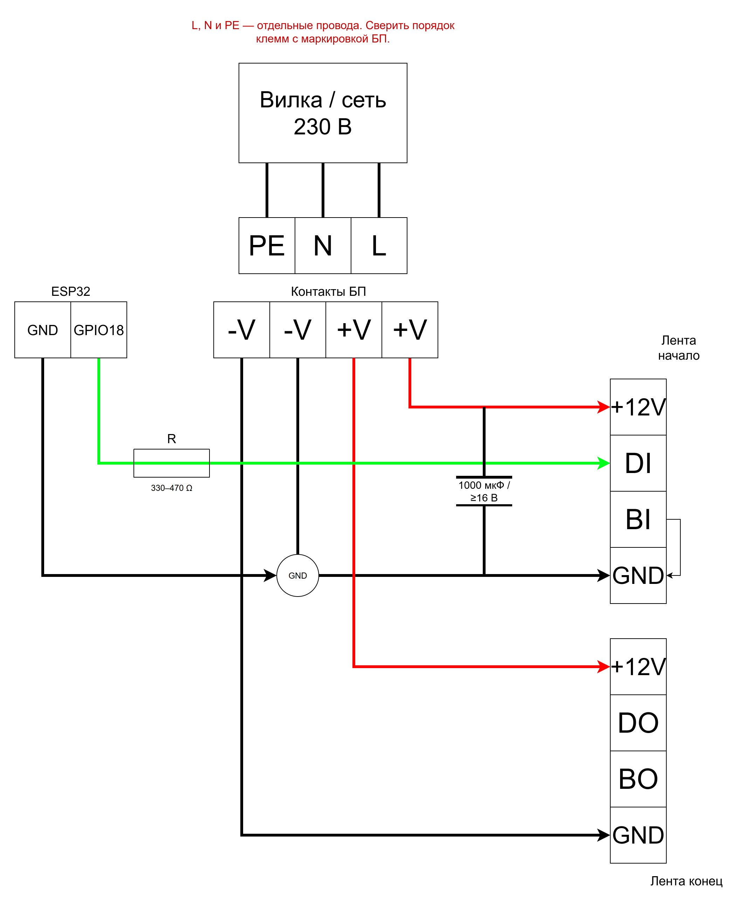

# Физическая схема Ambilight

Этот документ фиксирует согласованную схему первого аппаратного прототипа:
лента WS2815 питается от одного БП 12 В с начала и конца, ESP32 сначала
питается только от USB компьютера, а короткая линия данных подключается к
ленте напрямую через последовательный резистор 330–470 Ом. Буфер уровня
3,3 → 5 В добавляется только при фактических проблемах с сигналом.

> [!WARNING]
> Сетевая часть 230 В пока не утверждена: неизвестны модель БП, устройство его
> входа, класс защиты и маркировка клемм. Не подключайте БП к вилке и не
> включайте его до проверки этих данных. Этот документ не заменяет руководство
> конкретного БП и проверку квалифицированным электриком.

## Исходные компоненты

| Компонент | Принято для прототипа |
| --- | --- |
| Лента | WS2815, 12 В, 5 м, 60 LED/м, 300 пикселей |
| Вход ленты | `GND`, `BI`, `DI`, `+12V` |
| Выход ленты | `GND`, `BO`, `DO`, `+12V` |
| Блок питания | 12 В / 10 А, точная модель ещё не записана |
| Силовые провода | 18 AWG для `+12V` и GND ленты |
| Сигнальные провода | 22 AWG для данных и общей земли |
| Конденсатор | 1000 мкФ; 16 В минимум для настроенного БП 12 В, 25 В предпочтительно при подходящих габаритах |
| Последовательный резистор | 330–470 Ом |
| Контроллер | Проверенная ESP32 DevKit с USB-UART CH9102X и microUSB |
| Буфер данных | Для первого прототипа не нужен; при помехах — `SN74AHCT125` или подтверждённый аналог |

Тип USB-UART-моста не участвует в управлении лентой: CH9102X используется только
для USB-связи компьютера с ESP32. Если позднее понадобится буфер, для него также
потребуются питание 5 В, керамический конденсатор 0,1 мкФ и согласованная схема
управления `OE`.

## Наглядная схема

[](images/hardware-wiring.png)

[Открыть редактируемый исходник draw.io](images/hardware-wiring.drawio)

Красные линии — `+12V`, чёрные — GND/`V-`, зелёная — сигнал данных. Клеммы
`L`, `N` и `PE` на рисунке соединены с сетью отдельными проводами и не должны
соединяться друг с другом. Порядок сетевых клемм обязательно сверяется с
маркировкой фактического БП.

## Общая схема

```text
                 СЕТЕВАЯ ЧАСТЬ — ПОКА НЕ СОБИРАТЬ

    сеть 230 В ── L / N / PE(если требуется) ── БП 12 В / 10 А
                                                  │
                         НИЗКОВОЛЬТНАЯ ЧАСТЬ      │
                                                  │
        V+ ─────────────┬── 18 AWG ── +12V начала ленты
                        └── 18 AWG ── +12V конца ленты

        V- ─────────────┬── 18 AWG ── GND начала ленты
                        ├── 18 AWG ── GND конца ленты
                        └── 22 AWG ── GND ESP32

    у начала ленты:
        +12V ────┬──────── лента
                 │ +
              1000 мкФ / ≥16 В
                 │ -
        GND ─────┴──────── лента

                              СИГНАЛ

    ПК ── USB ── ESP32
                 GPIO18 ── 330–470 Ом ──────────────────────── DI
                 GND ───────────────────────────────────────── GND
                                                               └── BI

    При проблемах с сигналом:
                 GPIO18 ── SN74AHCT125 3,3→5 В ── резистор ── DI

    BO и DO на выходном конце к ESP32 не подключаются.
```

`PE/FG` защитного заземления и `V-` выхода 12 В — разные узлы. Не соединяйте
их перемычкой самостоятельно: это допустимо только тогда, когда так требует
документация конкретного БП.

## Питание ленты

1. Используются две отдельные пары 18 AWG от БП: к началу и к концу ленты.
2. В каждой паре идут и `+12V`, и GND. Нельзя подавать с конца только плюс.
3. Средняя точка питания заранее не предусматривается. После монтажа решение
   проверяется измерением напряжения и нагрева в середине ленты.
4. Четырёхконтактные заводские разъёмы используются прежде всего для данных и
   соединения лент. Не пропускайте через неизвестный тонкий разъём весь ток
   пяти метров: силовые 18 AWG лучше припаять непосредственно к площадкам
   `+12V` и GND или к отдельным заводским проводам питания подходящего сечения.
5. Начало определяется надписями `DI/BI`, а конец — `DO/BO`. Пол разъёма
   «мама/папа» не доказывает направление данных.
6. Конденсатор устанавливается у начала ленты параллельно питанию. Плюсовой
   вывод идёт к `+12V`, вывод с полосой «−» — к GND. Выводы должны быть
   короткими, а открытые места — изолированы.

По решению владельца в первом прототипе отдельные предохранители ветвей 12 В
не устанавливаются. Это уменьшает защиту проводов и соединений при коротком
замыкании; программный лимит тока такую аварию не обнаруживает. Наличие и тип
внутренней защиты БП нужно проверить до первого включения. Требования к защите
сетевого входа этим решением не отменяются.

## Линия данных

- ESP32 и лента обязательно имеют общий GND.
- Для собранного прототипа используется подтверждённый GPIO18. Перед первой
  проверкой новой разводки следует вручную вернуть
  `CONFIG_AMBILIGHT_LED_DATA_GPIO=-1`.
- В первом прототипе GPIO18 соединяется с `DI` напрямую через последовательный
  резистор 330–470 Ом. Резистор располагается ближе к ESP32.
- Провод от ESP32 до первого пикселя желательно сделать длиной 10–30 см.
- Сигнальный провод желательно вести рядом или скрутить с отдельным проводом
  GND. Контроллер лучше разместить близко к входу ленты.
- `BI` первого пикселя соединяется с GND. `DO` и `BO` на конце ленты остаются
  неподключёнными.
- Когда БП ленты выключен, ESP32 не должна удерживать `DI` в высоком уровне.
  Для первого прототипа не оставляйте линию данных активной при обесточенной
  ленте.

Если при прямом подключении появятся случайные вспышки, неверные цвета или
нестабильный запуск, между GPIO18 и резистором добавляется `SN74AHCT125`.
Буфер питается от 4,5–5,5 В и требует конденсатор 0,1 мкФ непосредственно между
VCC и GND. Постоянно включённый буфер сам по себе не устраняет паразитное
питание через `DI`: для этого его выход нужно действительно отключать через
`OE`.

## Питание ESP32

На первом этапе ESP32 питается только через USB компьютера. К пинам `5V` и
`3V3` внешнее питание не подключается.

Если позднее понадобится автономная работа при выключенном ПК, будет отдельно
выбрана одна из схем: постоянно питаемый USB, ручное переключение источников
или power-mux с блокировкой обратного тока. До этого нельзя одновременно
подавать питание от USB и внешние 5 В. Для официальной ESP32-DevKitC эти
способы питания прямо указаны как взаимоисключающие; у клона схему питания
нужно проверять отдельно.

## Как использовать клеммы, НШВИ и пайку

| Место | Способ соединения |
| --- | --- |
| Многожильный провод в подходящей винтовой клемме | НШВИ правильного размера и обжим подходящими клещами |
| Пружинная клемма | По инструкции её производителя; НШВИ только если такой провод допустим |
| Площадка ленты | Пайка, затем механическая разгрузка и изоляция |
| Скрутка без клеммы или пайки | Не использовать |
| Облуженный многожильный конец под винтом | Не использовать: припой ползёт, прижим со временем ослабевает |
| Сетевая клемма БП | Только по инструкции БП; не заменять НШВИ пайкой |

НШВИ не увеличивает допустимый ток тонкого провода. Клемма, наконечник и
провод должны подходить друг другу по сечению и рабочему току.

## Что именно паять для первого прототипа

Все операции выполняются при отключённых USB и БП. После пайки каждый открытый
контакт изолируется, а тяжёлые провода закрепляются так, чтобы они не тянули
медные площадки ленты и платы.

### БП

**На самом БП паять ничего не нужно.**

- На концы двух пар 18 AWG со стороны низковольтных клемм `V+` и `V-`
  устанавливаются НШВИ подходящего размера.
- Если БП имеет несколько равнозначных клемм `V+` и `V-`, ветви начала и конца
  ленты подключаются к ним отдельно. Если подходящая клемма одна, две НШВИ под
  один винт не зажимаются без прямого разрешения производителя: используется
  рассчитанная на ток распределительная клемма.
- Многожильный провод перед винтовой клеммой не облуживается: припой со временем
  деформируется, и контакт может ослабнуть.
- Сетевой кабель 230 В также не припаивается к винтовым клеммам. Тип наконечника,
  подключение `L`, `N`, `PE` и корпус определяются только после проверки модели
  и маркировки БП.

### Лента

**У входа ленты (`DI/BI`) припаять:**

1. Провод 18 AWG от `V+` БП к площадке `+12V`.
2. Провод 18 AWG от `V-` БП к площадке GND.
3. Конденсатор 1000 мкФ на 16 В или выше параллельно питанию: `+` к `+12V`,
   вывод с полосой «−» к GND. Номинал 16 В допустим для проверенного и
   настроенного на 12 В БП; 25 В даёт дополнительный запас. Выводы оставить
   короткими.
4. Короткую перемычку 22 AWG между `BI` и GND.
5. Сигнальный провод 22 AWG к `DI`. Второй, соседний с ним провод 22 AWG
   соединяет GND ESP32 с общим GND; его можно подключить через подходящую
   низковольтную клемму, не нагромождая ещё один провод на площадке ленты.

**У выходного конца ленты (`DO/BO`) припаять только:**

1. Провод 18 AWG от `V+` БП к `+12V`.
2. Провод 18 AWG от `V-` БП к GND.

`DO` и `BO` на выходном конце никуда не подключаются. Заводской четырёхпиновый
разъём не используется для передачи всего силового тока пяти метров, если
сечение его проводов и допустимый ток неизвестны.

### Плата ESP32

**Минимум для проверки:**

1. Если на плате уже установлены штырьковые разъёмы, к самой плате ничего паять
   не нужно: сигнал подключается к `GPIO18`, общая земля — к любому пину GND.
2. Резистор 330–470 Ом впаивается последовательно в сигнальный провод рядом с
   ESP32; обе пайки закрываются термоусадкой. Второй конец идёт к `DI` ленты.
3. Для постоянной сборки можно припаять к плате штырьковые разъёмы либо провода
   22 AWG к `GPIO18` и GND. Нельзя просто зажать голый провод в отверстии платы.
4. ESP32 питается только через microUSB. К `5V`, `VIN` и `3V3` ничего не
   припаивается и внешнее питание на них не подаётся.

CH9102X на плате соединяет ESP32 с USB и в цепь `GPIO18 → DI` не входит. Буфер
уровня в первом прототипе не распаивается; место для него понадобится только
при обнаруженных помехах.

## Что нужно узнать перед сетевой сборкой

Нужно записать с корпуса БП:

- производителя и точную модель;
- диапазон `AC INPUT`;
- полный порядок и маркировку входных и выходных клемм;
- наличие переключателя 115/230 В;
- обозначение класса I/II и клеммы `PE`, `FG` или символа заземления;
- перечисленные защиты: `SCP`, `OCP`, `OVP`, `OTP`;
- есть ли собственный входной предохранитель по документации.

Если это открытый металлический БП с винтовыми клеммами, он является
компонентом для установки внутрь корпуса. Нужны недоступность сетевых клемм,
разгрузка сетевого кабеля, вентиляция и защитное заземление корпуса, если БП
класса I. Сетевую сборку и первую проверку должен выполнить человек,
квалифицированный для работы с 230 В.

## Контроль перед первым включением

Этот этап выполняется только после сборки низковольтной части и проверки БП.

1. Лента полностью размотана; на катушке испытание не проводится.
2. БП обесточен, все соединения затянуты и изолированы, отдельные жилы не
   торчат из клемм.
3. Полярность обеих силовых пар и конденсатора проверена мультиметром.
4. Выход БП сначала измерен без ленты и настроен примерно на 12,0 В, если у
   модели есть регулировка.
5. Между `+12V` и GND нет постоянного короткого замыкания. Подключённый
   конденсатор может дать краткий сигнал прозвонки во время заряда.
6. Для новой разводки перед первым включением вручную выбирается `GPIO=-1`;
   отдельно проверяются USB, COM-порт и команды без ленты. GPIO18 включается
   только после сверки со схемой текущего прототипа.
7. После включения физического GPIO первый тест проводится с расчётным
   программным лимитом около 1 А и небольшой яркостью. Это уменьшает заданную
   яркость, но не измеряет реальный ток и не является защитой от замыкания.
8. Затем проверяются белый цвет, напряжение в начале, середине и конце, а
   также нагрев проводов, клемм и площадок.

## Источники и ограничения

- [Espressif: варианты питания ESP32-DevKitC](https://docs.espressif.com/projects/esp-dev-kits/en/latest/esp32/esp32-devkitc/user_guide.html#power-supply-options)
- [Texas Instruments: SN74AHCT125](https://www.ti.com/product/SN74AHCT125)
- [Worldsemi: семейство WS2815](https://world-semi.com/ws2815-family/)
- [Mean Well: общие правила установки корпусных БП](https://www.meanwell.com/Upload/PDF/Enclosed_Type_EN.pdf)

Ссылки задают общие технические принципы. Маркировка и руководство фактически
купленных БП, ленты, платы и буфера имеют приоритет.
